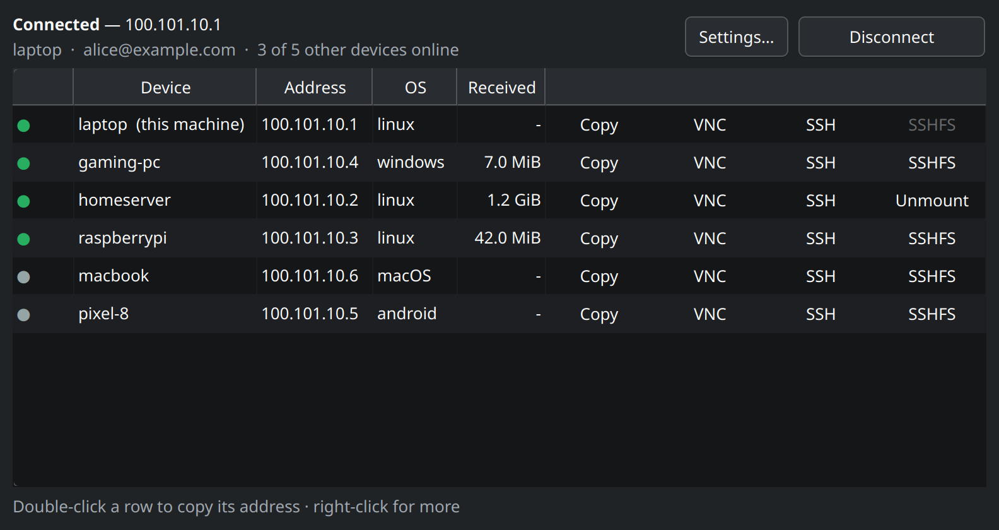

# Tailscale Panel

A small PySide6 window and tray icon for the tailnet. It lists every device
with its address and state, and turns Tailscale on or off. For each device it
can open VNC (Remmina), open an SSH terminal (Konsole), or mount the remote
home directory over SSHFS at `~/mnt/<device>`.

It only calls the `tailscale` CLI. No sudo is needed once your user is the
operator:

    sudo tailscale set --operator=$USER

## Files

- `tailscale-panel`: the whole app (Python 3, PySide6)
- `tailscale-panel.desktop`: the app-launcher entry (`@BIN@` is filled in by the installer)
- `tailscale-panel.svg`: the launcher and window icon
- `install.sh`: copies all three into `~/.local`

## Use

    ./install.sh                 # install or update
    tailscale-panel              # open the window
    tailscale-panel --selftest   # print parsed status, no GUI

## VNC client

Settings… (in the window or the tray menu) picks the VNC client. The default,
Remmina (auto), opens the device's saved Remmina profile when there is one and
`vnc://<host>:<port>` otherwise. Any other client is a command template, run
without a shell, with these placeholders:

- `{host}`: the hostname if it resolves, else the tailnet address
- `{ip}`: the tailnet address
- `{name}`: the short device name
- `{port}`: the port from Settings (default 5900)

For example `vncviewer {host}::{port}` (TigerVNC) or `krdc vnc://{host}:{port}`.
The choice is saved in `~/.config/tailscale-panel/config.json` and read on
every launch, so hand edits apply without a restart.

## SSH user

SSH and SSHFS log in as ssh's default user: whatever `~/.ssh/config` says,
else your local user name. To use another one for a device, right-click it
and pick SSH user…. It is saved under `ssh_users` in the same config file,
keyed by device name, and a blank entry goes back to the default.

## Renaming devices

Right-click a device and pick Rename… to change its tailnet name, the one the
admin console and MagicDNS use. The table shows that name; connections, mount
points and SSH users still go by the OS hostname, which renaming leaves alone.
A blank name hands naming back to the OS hostname.

This machine is renamed with `tailscale set --hostname`, which needs no key
but does need your user to be the operator (see the top of this file). The
device name follows the hostname unless it was set by hand in the admin
console; the panel checks and says so when it did not change.

Any other device goes through the admin API, since the CLI can only rename
the machine it runs on. That needs an API access token from
<https://login.tailscale.com/admin/settings/keys>. The first rename asks for
it and saves it, owner-only, to `~/.config/tailscale-panel/api-key`. When
Tailscale rejects it (they expire after at most 90 days), the panel deletes it
and asks again on the next rename.

## Requirements

The shebang is `/usr/bin/python3`, so PySide6 comes from the system package:

    sudo apt install python3-pyside6.qtwidgets

`install.sh` refuses to install if that import fails. Optional tools:
`sshfs`, `remmina`, `konsole`, `ksshaskpass`, `dolphin`.
